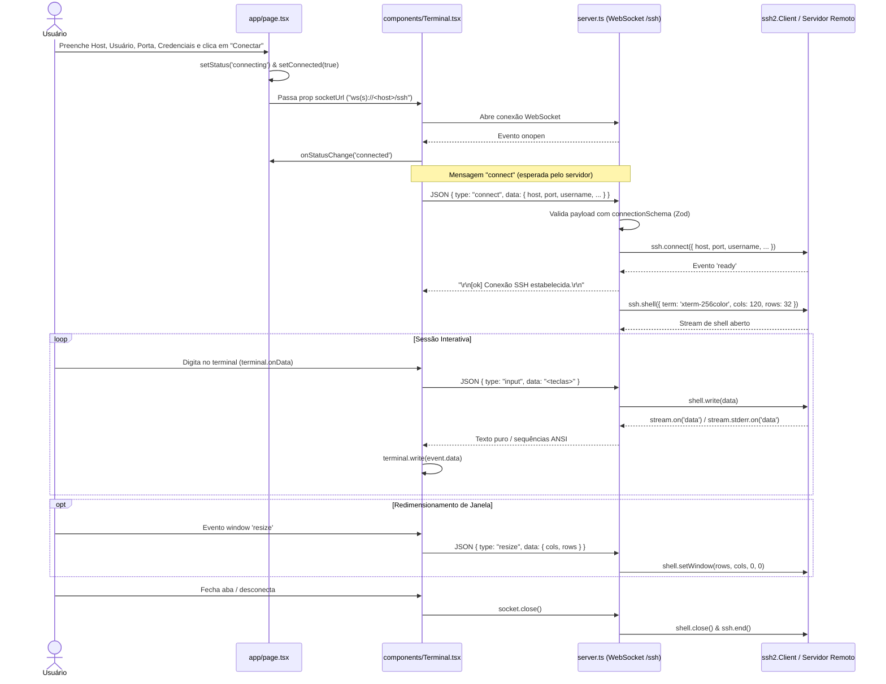

# Arquitetura e Protocolo de Comunicação

O **SSH Studio** opera sob uma arquitetura de três pontas:
1. **Navegador (Cliente React + Xterm.js):** Captura os dados de conexão e eventos de teclado/redimensionamento do usuário e renderiza a saída ANSI.
2. **Servidor Node.js Intermediário (`server.ts`):** Hospeda tanto o frontend Next.js quanto um `WebSocketServer` no caminho `/ssh`, atuando como ponte (proxy WebSocket-para-SSH).
3. **Servidor SSH Remoto:** Destino final da conexão gerenciada pela biblioteca `ssh2`.

---

## Diagrama de Arquitetura

```mermaid
flowchart LR
    subgraph Browser["Navegador (Cliente)"]
        UI["Página Principal (app/page.tsx)"]
        Term["Componente Terminal (components/Terminal.tsx)"]
        UI -->|socketUrl| Term
    end

    subgraph NodeServer["Servidor Node.js (server.ts)"]
        HTTP["http.Server (:3000)"]
        Next["Next.js Request Handler"]
        WSS["WebSocketServer (/ssh)"]
        Zod["Validação Zod (lib/ssh-validation.ts)"]
        SSHClient["ssh2.Client"]

        HTTP -->|Rotas Web| Next
        HTTP -->|Upgrade /ssh| WSS
        WSS -->|connect| Zod
        Zod -->|Dados válidos| SSHClient
    end

    subgraph Remote["Infraestrutura Remota"]
        TargetSSH["Servidor SSH (Porta 22 / custom)"]
    end

    UI -->|HTTP GET /| HTTP
    Term <-->|WebSocket ws:// ou wss://| WSS
    SSHClient <-->|Protocolo SSH2 (TCP)| TargetSSH
```

---

## Fluxo de Conexão e Sessão (Sequência)



---

## Protocolo WebSocket (`/ssh`)

A comunicação no endpoint `/ssh` é assimétrica:
- **Cliente → Servidor:** Mensagens estruturadas em **JSON**.
- **Servidor → Cliente:** Strings em **texto bruto / sequências de escape ANSI** prontas para serem escritas diretamente no `XTerm`.

### 1. Mensagens Cliente → Servidor

#### `connect`
Inicia a conexão SSH com o servidor remoto. Validada por `connectionSchema` em `lib/ssh-validation.ts`.

```json
{
  "type": "connect",
  "data": {
    "host": "192.168.1.100",
    "port": 22,
    "username": "root",
    "password": "opcional",
    "privateKey": "opcional",
    "passphrase": "opcional"
  }
}
```

#### `input`
Envia caracteres digitados pelo usuário no Xterm.js para o canal `shell` ativo no `ssh2`.

```json
{
  "type": "input",
  "data": "ls -la\r"
}
```

#### `resize`
Informa ao canal SSH novas dimensões de colunas e linhas do terminal.

- **Formato esperado pelo servidor (`server.ts`, linhas 48–51):**
  ```json
  {
    "type": "resize",
    "data": {
      "cols": 120,
      "rows": 32
    }
  }
  ```
- **Nota de implementação atual:** O cliente em `components/Terminal.tsx` (linha 49) envia `{ type: 'resize', cols: terminal.cols, rows: terminal.rows }` na raiz do objeto (sem aninhar em `data`). Veja a seção de [Pontos de Atenção em Referência de Código](./referencia-codigo.md#pontos-de-atencao-e-divergencias-atuais) para mais detalhes.

---

### 2. Mensagens Servidor → Cliente

O servidor envia texto diretamente via `socket.send(payload)`:

| Evento no Servidor | Mensagem Enviada ao Terminal |
| :--- | :--- |
| Falha na validação Zod | `\r\n[erro] Dados de conexão inválidos: <mensagem>\r\n` |
| Conexão SSH pronta (`ready`) | `\r\n[ok] Conexão SSH estabelecida.\r\n` |
| Erro ao abrir shell | `\r\n[erro] Não foi possível abrir o shell: <error.message>\r\n` |
| Dados de `stdout` ou `stderr` do SSH | Conteúdo do `Buffer` convertido com `.toString()` |
| Fechamento do stream SSH (`close`) | `\r\n[sessão encerrada]\r\n` |
| Erro na conexão SSH (`error`) | `\r\n[erro] Falha SSH: <error.message>\r\n` |
| JSON malformado recebido pelo WS | `\r\n[erro] Mensagem inválida.\r\n` |

